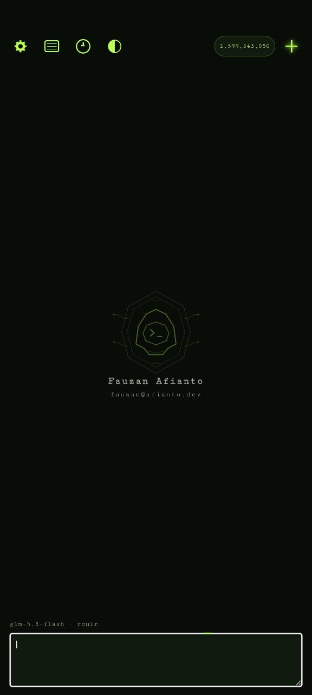
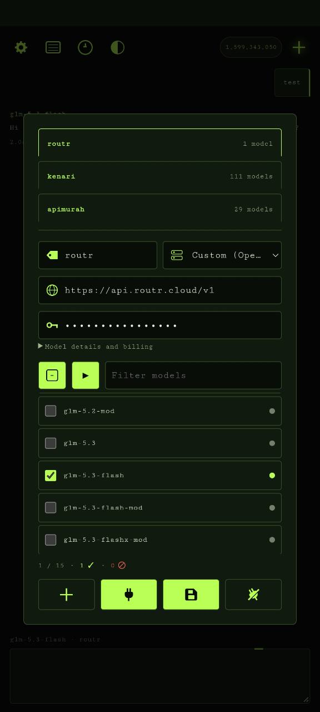

<div align="center">


# HackGpt

**A lightweight Android chat client for your own AI providers.**

[](https://github.com/thearticle/HackGpt/releases/latest)
[](#getting-started)
[](#build-from-source)

[Screenshots](#screenshots) · [Getting started](#getting-started) · [Chat controls](#chat-controls) · [Credits and quota](#credits-and-quota) · [Export and history](#export-and-history) · [What's new](#whats-new-in-v1014) · [Build](#build-from-source)

</div>

---

## Overview

HackGpt brings several online model providers into one Android app. Connect with your own API keys, choose the models you want in the picker, and chat in a lime-green terminal interface. The APK bundles the interface and uses Android System WebView, keeping the download small.

## Screenshots

<table>
  <tr>
    <td align="center"><a href="docs/screenshots/chat-toolbar.jpg"></a><br>Chat toolbar and quota</td>
    <td align="center"><a href="docs/screenshots/provider-settings.jpg"></a><br>Provider settings</td>
    <td align="center"><a href="docs/screenshots/model-picker.jpg"></a><br>Model picker</td>
  </tr>
  <tr>
    <td align="center"><a href="docs/screenshots/composer-and-visual-replies.jpg"></a><br>Circle and visual replies</td>
    <td align="center"><a href="docs/screenshots/history-bulk-actions.jpg"></a><br>History and bulk actions</td>
    <td align="center"><a href="docs/screenshots/appearance-settings.jpg"></a><br>Appearance settings</td>
  </tr>
</table>

## Features

| Feature | What you can do |
| --- | --- |
| **Multiple providers** | Use the OpenRouter, OpenAI, or Gemini presets, or connect to a custom OpenAI-compatible HTTPS endpoint. Browse and save models by provider. |
| **Streaming replies** | Read answers as they arrive and stop a response in progress. See response time, token counts, throughput, and reasoning summaries when the provider reports them. |
| **Rich formatting** | Read headings, lists, emphasis, code blocks, quotes, and scrollable tables directly in chat. |
| **Attachments** | Pick images, PDFs, and UTF-8 files such as TXT, CSV, or JSON. Choose a model that supports the selected file type. |
| **Searchable history and PDF export** | Find, rename, or delete chats. Save the current conversation as a PDF or download selected conversations as a ZIP of PDF transcripts on Android. |
| **Appearance and input** | Switch between Dark and Light, adjust the chat font size, toggle Enter-to-Send, or enable Full screen on Android. |

## Getting started

1. Install a signed APK on Android 8.0 or later and keep Android System WebView up to date. The v1.0.14 controls below describe the current source build. [GitHub Releases](https://github.com/thearticle/HackGpt/releases/latest)
2. Open **Settings** and choose a provider preset or enter a custom HTTPS API base URL. Add the provider's API key.
3. Tap the **plug** to load models. Check the ones you want in the picker, then tap the **disk** to save the provider.
4. Open **Select model** in the top bar. Search for a saved model, pick it, and write a message. Tap **+** to start a new chat.

The **play** icon in Settings sends a test request to each checked model. Your provider may charge for those requests.

## Chat controls

- **Regular mode.** Tap the pulsing marker above the message field to reveal the Send circle. Tap the circle to send. It pulses and gives light haptic feedback on Android.
- **Enter-to-Send mode.** Turn it on from **Appearance → ↵**. Press **Enter** to send or **Shift+Enter** for a new line. In the conversation area, tap twice quickly and hold the third tap to reveal the action circle. Swipe while holding or from the visible circle. A tap on the circle gives feedback without sending.
- **Move the circle.** When the pulsing marker is visible, hold it and drag left or right along the top of the message field. Release near the middle to snap to center. Other positions are saved and shared by both modes.

| Swipe from the circle | Action |
| --- | --- |
| ↑ Up | Open the attachment picker |
| ↓ Down | Export the current chat to PDF |
| ← Left | Select all text in the draft |
| → Right | Open the confirmation to clear the draft |

The focused circle also accepts the arrow keys. Its inner dot follows your swipe, then returns to center on release. The circle fades away after two idle seconds.

## Credits and quota

Look beside **+** in the chat header after choosing a model. **Routr** shows the selected model's available credits when reported. Tap the badge to switch between the abbreviated and exact count. **Kenari** shows the available rupiah balance, rounded to whole rupiah. **Demo → Beam 1.0 Free** displays **FREE** and can use a configured Kenari connection.

For more detail, open **Settings**, select the provider, and expand **Model details and billing**. Use **Refresh** and pick a model to see rates, context limits, and any minimum charge the provider reports. OpenRouter can show the amount remaining against the API key's spending limit.

## Export and history

**Single chat.** Open a conversation with a reply and swipe down from the circle. In the Android print sheet, choose **Save as PDF** and pick a destination. This export uses the formatted conversation.

**Bulk export.** Open **Chat history** from the top bar. Search by title, message, or attachment name, then hold a chat row to enter selection mode. Tap more rows to add them, or tap **☑** to select or deselect all visible search results. Tap **↓** beside the search field and choose where to save `HackGpt-chats.zip`. The ZIP contains one text-transcript PDF per selected chat, with attachment names listed in the transcript.

**Manage history.** Tap a row to reopen it. Outside selection mode, swipe a row right to rename it or left to delete it. In selection mode, use **⌫** to delete the selected chats after confirmation.

## What's new in v1.0.14

Changes since **v1.0.13**:

| Area | Update |
| --- | --- |
| **Chat controls** | A shared 62-pixel floating circle replaces the separate layouts. The marker can reposition it horizontally, snaps within 16 pixels of center, and remembers the chosen position. The circle fades and slides down after two idle seconds. |
| **Touch gestures** | The Enter-to-Send action circle opens from the conversation area on the held third tap. Message selection is suppressed during the gesture. The inner dot tracks swipes in all four directions and eases back on release. Regular Send gives a pulse and light vibration with the blue tap highlight removed. |
| **PDF export** | Swipe down to print or save the formatted current chat. Long-press in history to select multiple chats, select all visible search matches, export a ZIP of individual transcript PDFs, or delete the selection. |
| **Provider usage** | The header adds a Routr quota badge for the selected model alongside the existing Kenari balance and Beam demo indicator. Tap the Routr badge to toggle the exact credit count. |

## Visual replies

HackGpt displays images returned by supported models and can render bar charts, mind maps, flowcharts, org charts, and sequence diagrams in chat. Ask in plain language. HackGpt adds format guidance when it recognizes a request for a visual.

| To see a… | Try asking |
| --- | --- |
| Bar chart | “Draw a bar chart comparing 12 orders on Monday, 18 on Tuesday, and 15 on Wednesday.” |
| Mind map | “Make a mind map for planning a weekend in Bandung.” |
| Flowchart | “Draw a flowchart for resetting a forgotten password.” |
| Org chart | “Create an org chart for a small product team.” |
| Sequence diagram | “Show a sequence diagram for a checkout request between the customer, shop, and payment provider.” |

## Storage and connectivity

The Android app saves credentials using Android Keystore-backed encryption. Chat history and appearance preferences are stored on your device. Attachment names stay in history, and file contents remain available for the current app session.

Sending messages or running a model test sends the relevant inputs to your selected provider. Model capabilities and token reporting depend on that provider.

## Build from source

Use **JDK 17 or newer** and install **Android SDK 36**.

```powershell
git clone https://github.com/thearticle/HackGpt.git
cd HackGpt
.\gradlew.bat :app:assembleDebug
.\gradlew.bat :app:assembleRelease :app:lintRelease
```

Gradle writes APKs to `app/build/outputs/apk/`. Sign the release APK with your release key before distribution.

| Path | Role |
| --- | --- |
| `app/src/main/` | Android activity, file picker, provider networking, and credential storage |
| `preview/index.html` | Shared chat interface and visual reply rendering |
| `preview/server.cjs` | Local browser preview and provider request routing |

### Browser preview

On Windows with Node.js 22, run `node preview/server.cjs`. The preview uses its own Windows DPAPI credential store. [Open the local preview](http://localhost:8082/)

## Credits

Created by **Fauzan Afianto**. In the app, hold **+** for five seconds to reveal the credits screen. [thearticle on GitHub](https://github.com/thearticle)
