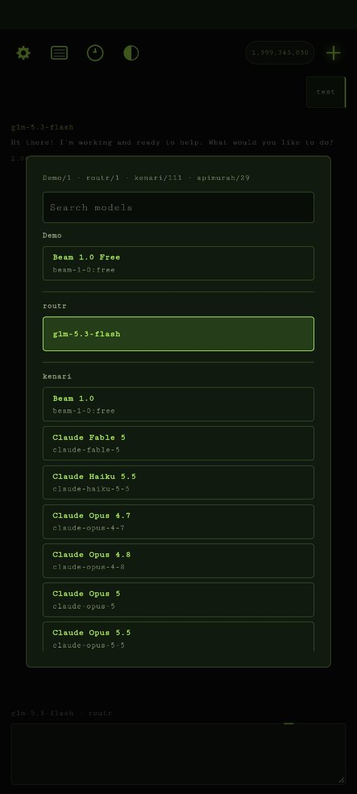
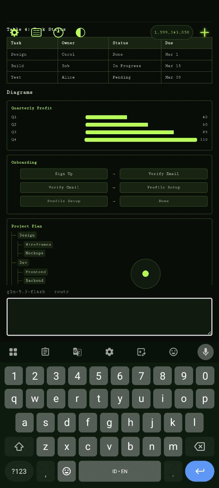
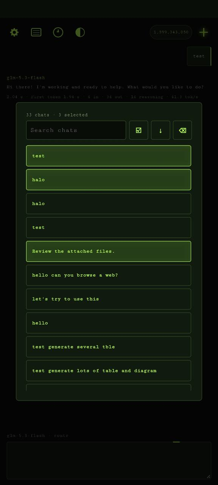
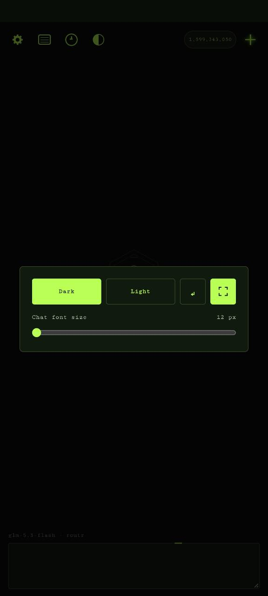

<div align="center">


# HackGpt

**A lightweight Android chat client for your own AI providers.**

[](https://github.com/thearticle/HackGpt/releases/latest)
[](#getting-started)
[](#build-from-source)

[Screenshots](#screenshots) · [Getting started](#getting-started) · [Chat controls](#chat-controls) · [Model details and quota](#model-details-and-quota) · [Export and history](#export-and-history) · [Visual replies](#visual-replies) · [Build](#build-from-source)

</div>

---

## Overview

HackGpt brings several online model providers into one Android app. Connect with your own API keys, choose the models you want in the picker, and chat in a lime-green terminal interface. The APK bundles the interface and uses Android System WebView, keeping the download small.

## Screenshots

<table>
  <tr>
    <td align="center"><a href="docs/screenshots/chat-toolbar.jpg"></a><br>Chat toolbar and quota</td>
    <td align="center"><a href="docs/screenshots/provider-settings.jpg"></a><br>Provider settings</td>
    <td align="center"><a href="docs/screenshots/model-picker.jpg"></a><br>Model picker</td>
  </tr>
  <tr>
    <td align="center"><a href="docs/screenshots/composer-and-visual-replies.jpg"></a><br>Circle and visual replies</td>
    <td align="center"><a href="docs/screenshots/history-bulk-actions.jpg"></a><br>History and bulk actions</td>
    <td align="center"><a href="docs/screenshots/appearance-settings.jpg"></a><br>Appearance settings</td>
  </tr>
</table>

## Features

| Feature | What you can do |
| --- | --- |
| **Multiple providers** | Use the OpenRouter, OpenAI, or Gemini presets, or connect to a custom OpenAI-compatible HTTPS endpoint. Browse and save models by provider. |
| **Streaming replies** | Read answers as they arrive and stop a response in progress. See response time, token counts, throughput, and reasoning summaries when the provider reports them. |
| **Rich formatting** | Read headings, lists, emphasis, code blocks, quotes, and scrollable tables directly in chat. |
| **Model details and tests** | Hold a model to see its reported pricing, token limits, and capabilities inside the picker. Use **▶** to check that it responds. |
| **Image generation and preview** | Generate images with supported models, including Kenari Nano Banana. Save the result or open a zoomable, rotatable preview. |
| **Attachments** | Pick images, PDFs, and UTF-8 files such as TXT, CSV, or JSON. Choose a model that supports the selected file type. |
| **Searchable history and Markdown export** | Find, rename, or delete chats. Save a conversation as Markdown or export selected conversations as a ZIP of Markdown files on Android. |
| **Appearance and input** | Switch between Dark and Light, adjust the chat font size, toggle Enter-to-Send, or enable Full screen on Android. |

## Getting started

1. Install the latest signed APK on Android 8.0 or later and keep Android System WebView up to date. [GitHub Releases](https://github.com/thearticle/HackGpt/releases/latest)
2. For a quick test, choose **Demo → Beam 1.0 Free** in **Select model**. To add your own account, open **Settings**, choose a preset or enter a custom HTTPS API base URL, and add the provider's API key.
3. Tap the **plug** to load models. Check the ones you want in the picker, then tap the **disk** to save the provider.
4. Open **Select model** in the top bar. Search for a saved model, pick it, and write a message. Tap **+** to start a new chat.

Settings always opens on the provider setup screen. Tap a saved provider in the scrollable three-column grid to edit it. The **▶** icon in Settings tests every checked model, and provider charges may apply.

When a newer APK is available on GitHub, Android shows an **↑** update icon beside **Appearance**. Tap it to download the APK, then open the downloaded file and confirm the update in Android.

## Chat controls

- **Regular mode.** Tap the pulsing marker above the message field to reveal the Send circle. Tap the circle to send. It pulses and gives light haptic feedback on Android.
- **Enter-to-Send mode.** Turn it on from **Appearance → ↵**. Press **Enter** to send or **Shift+Enter** for a new line. In the conversation area, tap twice quickly and hold the third tap to reveal the action circle. Swipe while holding or from the visible circle. A tap on the circle gives feedback without sending.
- **Move the circle.** When the pulsing marker is visible, hold it and drag left or right along the top of the message field. Release near the middle to snap to center. Other positions are saved and shared by both modes.
- **Resize the message field.** Drag either upper-corner grip up to expand the field or down to shrink it.

| Swipe from the circle | Action |
| --- | --- |
| ↑ Up | Open the attachment picker |
| ↓ Down | Export the current chat to Markdown |
| ← Left | Select all text in the draft |
| → Right | Open the confirmation to clear the draft |

The focused circle also accepts the arrow keys. Its inner dot follows your swipe, then returns to center on release. The circle fades away after two idle seconds.

### Continue with another model

Select another model during a chat to open a handoff card in the conversation. The card identifies the receiving model and provider. Choose **Summary** to review or edit a handoff before sending, **Full history** to share earlier prompts and replies, or **Fresh start** to send the next message alone while keeping earlier turns visible.

Slide from **Full history** on the left through **¾**, **½**, and **¼** summaries to **Fresh start** on the right. The fractions are approximate targets for how much of the original conversation to keep. The model buttons stay visible at every stop and are enabled at the summary levels. Tap either one to choose who summarizes. The new model is selected by default when it supports text replies. Tap the pulsing **▶** to open the summary field and generate a draft. Triple-tap the field to edit it.

**Include latest generated image** appears when the image is still available and the receiving model declares image input support. The collapsed handoff card records which mode you used.

## Model details and quota

Look beside **+** in the chat header after choosing a model. **Routr** shows the selected model's available credits when reported. Tap the badge to switch between the abbreviated and exact count. **Kenari** shows the available rupiah balance, rounded to whole rupiah. **Demo → Beam 1.0 Free** displays **FREE**.

Hold a model in **Select model** to select and highlight it. A card at the top of the picker shows reported prices, token limits, supported inputs, and image generation capability. Scroll below the card to browse more models. Tap **▶** to send a test request through the selected model and see whether it responds. Provider charges may apply.

If a test fails, the picker strikes through the model name and shows when it failed. Tap the marked row and use **▶** to retest. A successful retest clears the mark so you can select the model again.

## Export and history

**Single chat.** Open a conversation with a reply and swipe down from the circle. Pick a destination for the Markdown file. The filename starts with the chat's UTC date and time, followed by its title, for example `2026-11-22T08-30-00Z - Weekend plan.md`.

**Bulk export.** Open **Chat history** from the top bar. Search by title, message, or attachment name, then hold a chat row to enter selection mode. Tap more rows to add them, or tap **☑** to select or deselect all visible search results. Tap **↓** beside the search field and pick a destination for the timestamped ZIP. It contains one Markdown file per chat, using the same filename format as single export.

Both exports preserve the original Markdown, including headings, tables, code blocks, and diagram source, along with attachment names and available response details.

**Manage history.** Tap a row to reopen it. Outside selection mode, swipe a row right to rename it or left to delete it. In selection mode, use **⌫** to delete the selected chats after confirmation.

## Visual replies

HackGpt displays images returned by supported models and can render bar charts, mind maps, flowcharts, org charts, and sequence diagrams in chat. Ask in plain language. HackGpt adds format guidance when it recognizes a request for a visual.

Tap the pulsing **↓** under a generated image to save it. Double-tap or hold the image to open a centered preview. Pinch to zoom, twist two fingers to rotate in 90° steps, and tap the background to close. The line below the image shows elapsed time, pixel dimensions, file size, and format, plus provider-reported tokens and cost when available.

| To see a… | Try asking |
| --- | --- |
| Bar chart | “Draw a bar chart comparing 12 orders on Monday, 18 on Tuesday, and 15 on Wednesday.” |
| Mind map | “Make a mind map for planning a weekend in Bandung.” |
| Flowchart | “Draw a flowchart for resetting a forgotten password.” |
| Org chart | “Create an org chart for a small product team.” |
| Sequence diagram | “Show a sequence diagram for a checkout request between the customer, shop, and payment provider.” |

## Storage and connectivity

The Android app saves credentials using Android Keystore-backed encryption. Chat history and appearance preferences are stored on your device. Attachment names stay in history, and file contents remain available for the current app session.

Sending messages or running a model test sends the relevant inputs to your selected provider. Model capabilities and token reporting depend on that provider.

## Build from source

Use **JDK 17 or newer** and install **Android SDK 36**.

```powershell
git clone https://github.com/thearticle/HackGpt.git
cd HackGpt
.\gradlew.bat :app:assembleDebug
.\gradlew.bat :app:assembleRelease :app:lintRelease
```

Gradle writes APKs to `app/build/outputs/apk/`. Sign the release APK with your release key before distribution.

| Path | Role |
| --- | --- |
| `app/src/main/` | Android activity, file picker, provider networking, and credential storage |
| `preview/index.html` | Shared chat interface and visual reply rendering |
| `preview/server.cjs` | Local browser preview and provider request routing |

### Browser preview

On Windows with Node.js 22, run `node preview/server.cjs`. The preview uses its own Windows DPAPI credential store. [Open the local preview](http://localhost:8082/)

## Credits

Created by **Fauzan Afianto**. In the app, hold **+** for five seconds to reveal the credits screen. [thearticle on GitHub](https://github.com/thearticle)
